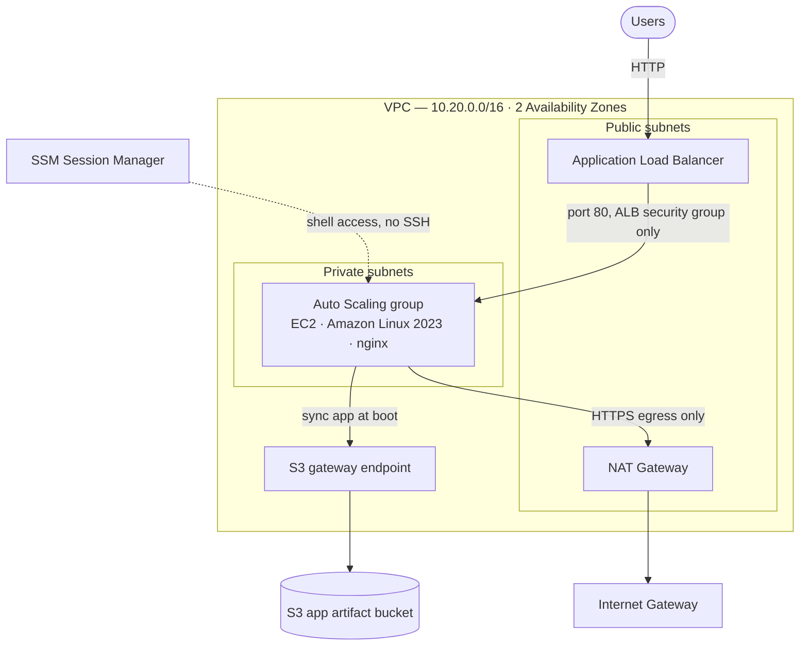
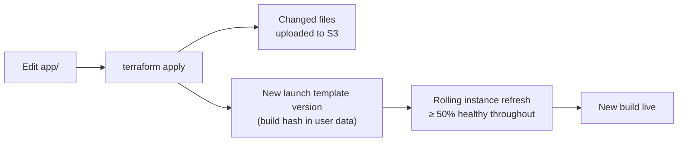

# AWS Web Platform — Terraform

[](https://github.com/GITHUB_USERNAME/aws-web-platform/actions/workflows/terraform-ci.yml)

Highly available web platform on AWS, built with reusable Terraform modules: a multi-AZ VPC,
an Application Load Balancer, and an Auto Scaling group of private EC2 instances with no
inbound SSH. The application ships as a versioned S3 artifact and rolls out with zero
downtime. State is stored remotely in S3 with locking, and every change is checked in CI.

The demo application is a browser Snake game. Its footer shows which instance, Availability
Zone and build served the page, so refreshing shows the load balancer at work.

## Architecture



## Application delivery



- **The build is versioned by content.** Terraform hashes every file in `app/` and renders the hash into the instances' user data. Any change to the app produces a new launch template version.
- **Rollouts have zero downtime.** A new launch template version triggers an Auto Scaling instance refresh that replaces instances in batches while at least 50% stay healthy behind the load balancer.
- **The artifact bucket is private.** Instances get read-only access to that one bucket through their IAM role, and the bucket is encrypted with all public access blocked.
- **S3 traffic uses a gateway endpoint**, so artifact downloads stay on the AWS network and skip NAT data-processing charges.
- **Failed deploys fail closed.** Instances start from an empty web root and abort boot if the app doesn't arrive, so a bad deploy fails its health checks and gets replaced rather than serving a default page.

## Components

### Network — `modules/vpc`

- **Public and private subnets in each Availability Zone.** CIDRs are derived with `cidrsubnet()`, so adding a zone never renumbers existing subnets.
- **Subnets keyed by AZ name** (`for_each`, not `count`), so changing the zone count doesn't destroy and recreate unrelated subnets.
- **Locked-down default security group.** All rules are removed, so nothing can attach to it by accident.
- **Single NAT gateway** for private subnet egress, which keeps non-production cost down. Production would run one per AZ.
- **S3 gateway endpoint** on the private route table (no hourly charge).
- **Validated inputs** (CIDR size, zone count) and consistent tagging through provider `default_tags`.

### Web tier — `modules/web`

**Security**

- Instances live in **private subnets** and accept traffic **only from the load balancer's security group**. Egress is limited to HTTPS, for package repositories and SSM.
- **No SSH and no key pairs.** Shell access goes through SSM Session Manager, via an instance role limited to `AmazonSSMManagedInstanceCore`.
- **IMDSv2 enforced** with a hop limit of 1, which blocks SSRF-style credential theft from instance metadata.
- **Encrypted gp3 root volumes**, and the load balancer drops invalid HTTP headers.
- **Optional HTTPS:** passing an ACM certificate ARN adds a TLS 1.3 listener and redirects HTTP to HTTPS.

**Reliability**

- Instances are spread **across both Availability Zones** behind the load balancer.
- **ELB health checks** against a dedicated `/health` endpoint, so failed instances are replaced automatically.
- **Target tracking scaling** holds average CPU at 50%.
- **Rolling instance refresh:** a new launch template version rolls out while keeping at least 50% of capacity healthy.
- **AMI resolved from AWS's public SSM parameter,** so new instances always launch from the latest patched Amazon Linux 2023 without hardcoded IDs.

### Remote state — `bootstrap/`

- **Native S3 locking** (`use_lockfile`, Terraform ≥ 1.10). No DynamoDB table is needed.
- **Versioned bucket**, so any state write can be rolled back. Old versions expire after 90 days.
- **Encrypted at rest, TLS enforced** by bucket policy, all public access blocked, and object ownership enforced.
- **`prevent_destroy`** on the bucket, since losing it would orphan every managed resource.
- **Partial backend configuration.** The bucket name is passed at `init` time through a git-ignored `backend.hcl`, so no account details are committed.

The bucket is created by `bootstrap/`, a small configuration that is applied once per
account with local state, because the bucket has to exist before anything can store state in it.

### Continuous integration — `.github/workflows`

Every push and pull request runs a GitHub Actions pipeline that checks the code without
touching AWS. It needs no cloud credentials and has read-only repository permissions.

| Check | What it catches |
|---|---|
| `terraform fmt` | Inconsistent formatting |
| `terraform validate` | Invalid syntax and broken references, for each root and module, run in parallel |
| TFLint (recommended preset) | Unused variables, missing types or descriptions, missing version constraints, deprecated syntax |

Superseded runs on the same branch are cancelled automatically.

## Repository layout

```
.
├── .github/workflows/  # CI: fmt, validate, TFLint
├── app/                # Static application (browser Snake game)
├── bootstrap/          # One-time: S3 bucket for remote state
├── environments/
│   └── dev/            # Composes modules for the dev environment
└── modules/
    ├── vpc/            # VPC, subnets, internet gateway, NAT, routing
    └── web/            # ALB, security groups, IAM, artifact bucket, launch template, Auto Scaling
```

## Usage

Requires Terraform ≥ 1.10 and AWS credentials for the target account.

**1. Create the state bucket (once per account)**

```bash
cd bootstrap
terraform init
terraform apply
```

**2. Deploy an environment**

```bash
cd environments/dev
cp backend.hcl.example backend.hcl            # set bucket to the bootstrap output
cp terraform.tfvars.example terraform.tfvars
terraform init -backend-config=backend.hcl
terraform plan
terraform apply
```

Open the `app_url` output after a couple of minutes, once the instances pass their health
checks. The game's footer names the instance, Availability Zone and build that served it.
To see the load balancer distributing traffic from the command line:

```bash
for i in 1 2 3 4 5 6; do curl -s "$(terraform output -raw app_url)/instance.json"; echo; done
```

**Deploy a change**

Edit anything in `app/`, then run `terraform apply`. The plan shows the changed files and a
new launch template version, and the instance refresh rolls the new build out. Its progress
is under **EC2 → Auto Scaling groups → Instance refresh**.

**Shell access**

```bash
aws ssm start-session --target <instance-id>
```

This requires the AWS CLI Session Manager plugin.

**Tear down**

```bash
terraform destroy
```

The NAT gateway, load balancer and instances are billed hourly. The state bucket is not
affected by an environment's `destroy`.
