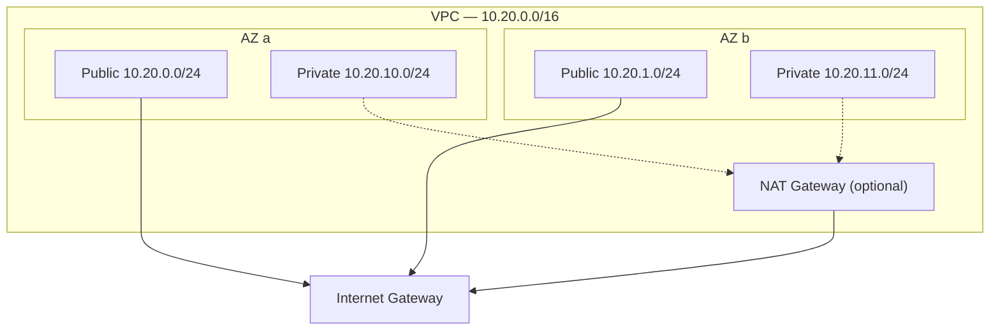

# AWS Web Platform — Terraform

Terraform for a multi-AZ web platform on AWS, built from reusable modules with one thin
composition per environment.

## Current scope

### Network foundation

The `vpc` module provisions the network layer the rest of the platform builds on.



- **Public and private subnets in each Availability Zone.** CIDRs are derived with `cidrsubnet()`, so adding a zone never renumbers existing subnets.
- **Subnets keyed by AZ name** (`for_each`, not `count`), so changing the zone count doesn't destroy and recreate unrelated subnets.
- **Locked-down default security group.** All rules are removed, so nothing can attach to it by accident.
- **Optional single NAT gateway** for private subnet egress. It's off by default in dev because it's billed hourly. Production would run one per AZ.
- **Validated inputs** (CIDR size, zone count) and consistent tagging through provider `default_tags`.

### Remote state

Each environment stores its state in S3 rather than on a workstation, so state is durable,
shared and protected from concurrent runs.

- **Native S3 locking** (`use_lockfile`, Terraform ≥ 1.10). No DynamoDB table is needed.
- **Versioned bucket**, so any state write can be rolled back. Old versions expire after 90 days.
- **Encrypted at rest, TLS enforced** by bucket policy, all public access blocked, and object ownership enforced.
- **`prevent_destroy`** on the bucket, since losing it would orphan every managed resource.
- **Partial backend configuration.** The bucket name is passed at `init` time through a git-ignored `backend.hcl`, so no account details are committed.

The bucket is created by `bootstrap/`, a small configuration that is applied once per
account with local state, because the bucket has to exist before anything can store state in it.

## Repository layout

```
.
├── bootstrap/          # One-time: S3 bucket for remote state
├── environments/
│   └── dev/            # Composes modules for the dev environment
└── modules/
    └── vpc/            # VPC, subnets, internet gateway, NAT, routing
```

## Usage

Requires Terraform ≥ 1.10 and AWS credentials for the target account.

**1. Create the state bucket (once per account)**

```bash
cd bootstrap
terraform init
terraform apply
```

**2. Deploy an environment**

```bash
cd environments/dev
cp backend.hcl.example backend.hcl            # set bucket to the bootstrap output
cp terraform.tfvars.example terraform.tfvars
terraform init -backend-config=backend.hcl
terraform plan
terraform apply
```

Without the NAT gateway, every resource in the `dev` environment is free. The state
bucket costs a few cents a month.
