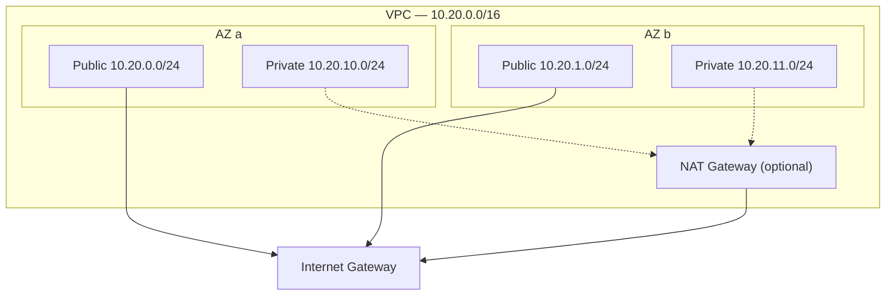

# AWS Web Platform — Terraform

Terraform for a multi-AZ web platform on AWS, built from reusable modules with one thin
composition per environment.

## Current scope: network foundation

The `vpc` module provisions the network layer the rest of the platform builds on.



- **Public and private subnets in each Availability Zone.** CIDRs are derived with `cidrsubnet()`, so adding a zone never renumbers existing subnets.
- **Subnets keyed by AZ name** (`for_each`, not `count`), so changing the zone count doesn't destroy and recreate unrelated subnets.
- **Locked-down default security group.** All rules are removed, so nothing can attach to it by accident.
- **Optional single NAT gateway** for private subnet egress. It's off by default in dev because it's billed hourly. Production would run one per AZ.
- **Validated inputs** (CIDR size, zone count) and consistent tagging through provider `default_tags`.

## Repository layout

```
.
├── environments/
│   └── dev/        # Composes modules for the dev environment
└── modules/
    └── vpc/        # VPC, subnets, internet gateway, NAT, routing
```

## Usage

Requires Terraform ≥ 1.10 and AWS credentials for the target account.

```bash
cd environments/dev
cp terraform.tfvars.example terraform.tfvars
terraform init
terraform plan
terraform apply
```

Without the NAT gateway, every resource in this configuration is free.
